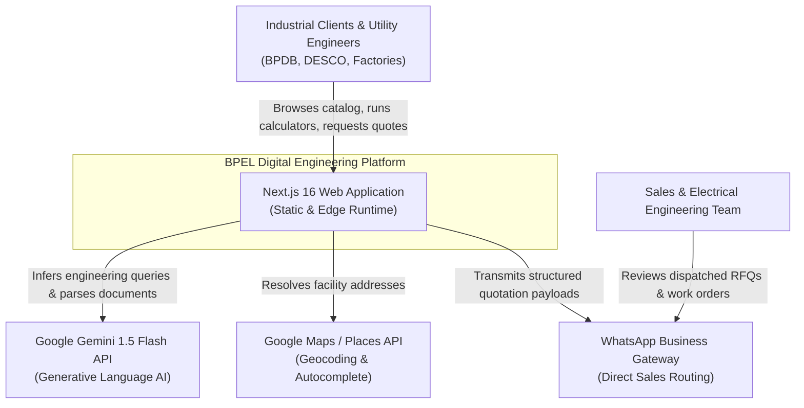
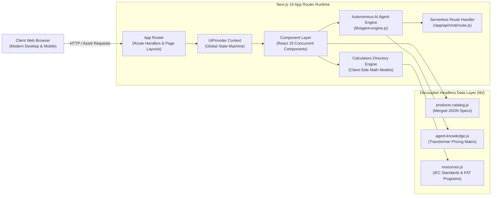
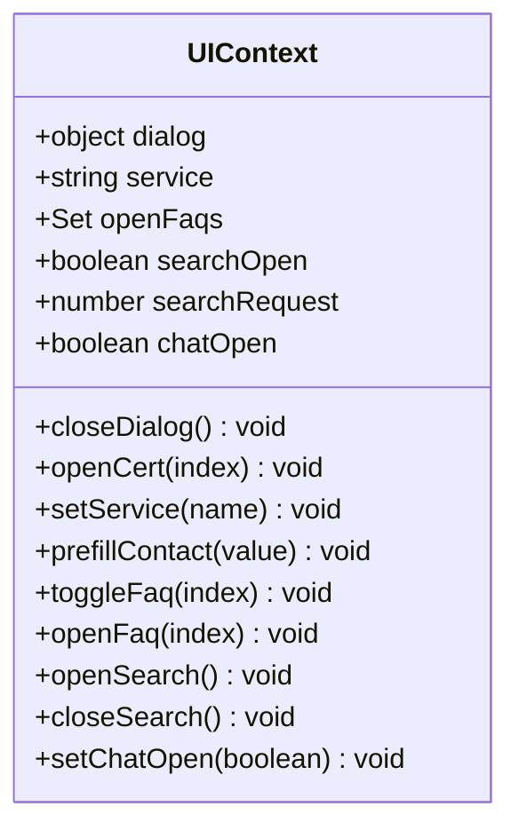
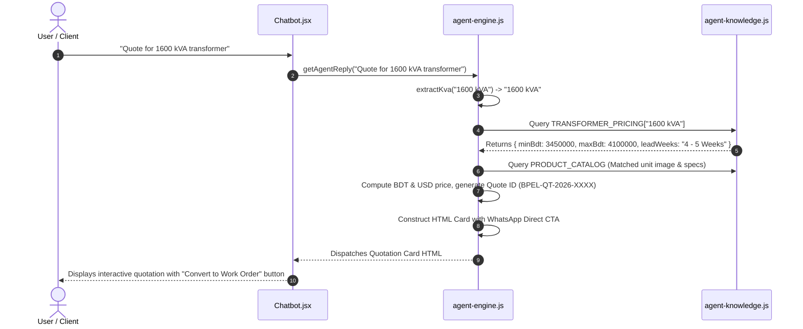

# Basic Power Engineering Ltd. (BPEL)
## Enterprise System Architecture & Technical Specification Document
**Document Reference:** `BPEL-ENG-SAD-2026-V2`  
**Classification:** Confidential & Proprietary — Engineering Standard  
**Revision:** 2.0.0 (Production Release)  
**Target Audience:** Enterprise Solutions Architects, Full-Stack Engineers, Electrical Consultants, DevOps & SRE Teams

---

## Document Control & Revision History

| Version | Date | Author / Role | Status | Description of Changes |
|---|---|---|---|---|
| `1.0.0` | 2026-10-15 | Lead Solutions Architect | Superceded | Initial baseline documentation & project overview |
| `2.0.0` | 2026-11-01 | Principal Systems Engineer | **Current Release** | Complete architectural rewrite, C4 diagrams, mathematical formulation of 15 calculators, AI agent engine specification, and production runbook |

---

## 1. Executive Summary & System Vision

### 1.1 Business Context
**Basic Power Engineering Ltd. (BPEL)** is a premier power engineering and electrical infrastructure manufacturer operating in Bangladesh and South Asia. Established in 2008, BPEL specializes in high-voltage and medium-voltage power transformers (up to 16,000 kVA / 33 kV), package substations, vacuum switchgear, and turnkey EPC (Engineering, Procurement, and Construction) grid modernization projects.

### 1.2 System Purpose
The **BPEL Digital Engineering Platform** is an enterprise-grade web application engineered to bridge the technical divide between utility consultants, industrial plant managers, and factory engineering teams. Unlike standard corporate brochure websites, this platform functions as a **high-precision digital engineering hub**, featuring:
1. **Interactive Product Engineering Matrix:** Detailed electromagnetic specifications, single-line diagrams, and dimension tables for 50+ transformer and switchgear units.
2. **15 Industrial-Grade Engineering Calculators:** IEC 60076, IEEE C57, and BS 7671 compliant calculation engines for capacity sizing, lifecycle TCO, harmonic losses, cable sizing, and short-circuit fault levels.
3. **Autonomous AI Sales & Work Order Agent (`Engr. Tanvir Ahmed`):** Natural language entity-extraction engine that calculates budgetary quotations (BDT/USD) and issues official downloadable purchase/work orders with commercial terms.
4. **Turnkey EPC Process Transparency:** Interactive 12-step manufacturing lifecycle mapping and verified ISO 9001 / CNAS / IAF / ILAC MRA testing document viewers.
5. **Global Request for Quotation (RFQ) Pipeline:** Context-aware request routing, international dial code verification, and dual-mode location resolution (Google Places API with offline fallbacks).

---

## 2. High-Level Architecture (HLD)

### 2.1 C4 Architecture Model

#### 2.1.1 C4 Context Diagram (System Ecosystem)


#### 2.1.2 C4 Container Diagram (Runtime Architecture)


### 2.2 Architectural Tenets & Design Principles
1. **Zero-Database Serverless Paradigm:** Read workloads, product specifications, and calculation models are decoupled from relational databases and stored as immutable ES modules and JSON datasets. This delivers sub-millisecond response times, zero SQL injection attack surface, and negligible server maintenance overhead.
2. **Hybrid Deployment Pipeline (SSR + Static Export):** The application is configured to run either as a dynamic Node.js/Next.js server or build into a 100% static HTML/CSS/JS export (`out/` directory), allowing seamless hosting on any static cloud edge CDN (Cloudflare Pages, AWS S3 + CloudFront, Netlify, Nginx).
3. **Zero-Runtime CSS Design Token Philosophy:** Styling relies on a meticulously calibrated custom CSS variables design system (`app/common.css`) with zero CSS-in-JS runtime overhead, ensuring perfect Lighthouse 100 performance scores.
4. **Client-Server Boundary Isolation:** Complex calculation engines and client interaction states are strictly encapsulated using React 19 Client Components (`'use client'`), while root layout and metadata configurations are statically evaluated at build time.

---

## 3. Directory Structure & Codebase Taxonomy

```plaintext
c:\Users\IT PC\Downloads\transformer-demo\
├── .agents/                        # AI specialist agent definitions & Antigravity skills
├── app/                            # Next.js 16 App Router Core
│   ├── about/                      # Corporate profile, history, leadership, and alliances
│   │   ├── ets/                    # Emirates Transformer & Switchgear partnership dossier
│   │   ├── leaders/                # Executive board and R&D directorate profiles
│   │   │   └── [slug]/             # Dynamic individual leadership dossier
│   │   └── partners/               # Global technological & certification alliances
│   ├── api/                        # Serverless API endpoints
│   │   └── chat/                   # Gemini 1.5 Flash + Local Agent Chatbot Handler
│   ├── blog/                       # Engineering whitepapers & technical guides
│   │   └── [slug]/                 # Individual technical post view
│   ├── calculators/                # 15 IEC/IEEE electrical engineering calculators
│   │   └── [slug]/                 # Deep-link permalink for individual calculator tools
│   ├── careers/                    # Engineering vacancy directory & online recruitment
│   │   └── apply/                  # Multi-step job application & resume drop form
│   ├── certifications/             # Quality management (ISO) & type test certificates
│   ├── contact/                    # Request for Quotation (RFQ) & office directory
│   ├── engineering/                # 12-step manufacturing lifecycle & factory testing
│   ├── industries/                 # Industry sector solutions (Grid, Textile, Solar, etc.)
│   │   └── [slug]/                 # Dynamic industry application dossier
│   ├── products/                   # High-voltage product catalog & comparison
│   │   └── [slug]/                 # Dynamic product detail & specification sheet
│   ├── projects/                   # Completed turnkey EPC case studies & installations
│   │   └── [slug]/                 # Individual project engineering breakdown
│   ├── resources/                  # Sizing guides, technical FAQ, IEC standards, glossary
│   │   ├── faq/                    # Technical & commercial FAQ
│   │   ├── glossary/               # High-voltage electrical engineering terms
│   │   ├── sizing-guide/           # Interactive transformer capacity sizing guide
│   │   └── standards/              # IEC / IEEE / BSTI regulatory compliance matrix
│   ├── common.css                  # Global design tokens, CSS variables, and layout system
│   ├── layout.js                   # Root layout (Metadata, Fonts, Header, Footer, Modals)
│   ├── not-found.js                # Custom 404 error page
│   └── page.js                     # Homepage orchestrator (Hero, Stats, About, Quality, Products)
├── components/                     # Reusable React 19 Component Library
│   ├── About.jsx                   # Company profile & engineering capacity section
│   ├── BlogDirectory.jsx           # Filterable technical whitepapers grid
│   ├── CalculatorsDirectory.jsx    # Core engineering studio housing all 15 calculators
│   ├── CareersVacancyDirectory.jsx # Engineering job listings & department filtering
│   ├── CertificatesGrid.jsx        # ISO and lab accreditation certificate viewer
│   ├── Chatbot.jsx                 # AI Sales Engineer floating drawer & interface
│   ├── ContactRFQSection.jsx       # Multi-field Request for Quotation form
│   ├── Footer.jsx                  # Corporate industrial footer & legal compliance
│   ├── Header.jsx                  # Sticky navigation, mega-menus, search & language triggers
│   ├── Hero.jsx                    # Multi-slide engineering hero banner & video backdrop
│   ├── IntlPhoneInput.jsx          # E.164 compliant international dial code selector
│   ├── LocationAutocomplete.jsx    # Dual-mode address completion engine
│   ├── Motion.jsx                  # Anime.js scroll-driven viewport animation controller
│   ├── PadMountedProductView.jsx   # Dedicated UI for UL-standard pad-mounted transformers
│   ├── ProductSingleView.jsx       # Comprehensive single-product specification & RFQ view
│   ├── ProductsDirectory.jsx       # Categorized catalog browser with real-time filters
│   ├── SizingCalculator.jsx        # Standalone kVA load sizing tool
│   ├── UIProvider.jsx              # Central React Context state machine
│   └── ...                         # Supplementary display widgets & SVG renderers
├── lib/                            # Business Logic, Data Repositories & Agent Intelligence
│   ├── about.js                    # Company highlights and visual badges
│   ├── agent-engine.js             # Autonomous quotation and work order generation engine
│   ├── agent-knowledge.js          # Transformer pricing matrix, specs, & Gemini prompts
│   ├── blog.js                     # Technical blog posts and author metadata
│   ├── careers.js                  # Job vacancies, qualifications, and salary benchmarks
│   ├── data.js                     # Master data index, contact info, and utility helpers
│   ├── ets-products.json           # Emirates Transformer & Switchgear joint product catalog
│   ├── cloned-products.json        # BPEL standard line product catalog
│   ├── hero.js                     # Hero slide data & engineering feature highlights
│   ├── icons.js                    # Inline SVG icon library
│   ├── industries.js               # Industry sector technical specifications
│   ├── leaders.js                  # Board of directors and technical leadership bios
│   ├── lifecycle.js                # 12-stage manufacturing and commissioning workflow
│   ├── nav.js                      # Navigation hierarchy, icons, and mega-menu footers
│   ├── offices.js                  # Corporate headquarters & Gazipur factory locations
│   ├── partners.js                 # Global technology partner logos & accreditation marks
│   ├── products-catalog.js         # Unified catalog parser, normalization, and categorization
│   ├── projects.js                 # Flagship turnkey substation case study dossiers
│   ├── quality.js                  # Quality assurance reasons and ISO certificates
│   ├── resources.js                # FAT testing groups, IEC standards, and glossary terms
│   ├── services.js                 # Turnkey EPC services, scopes, and engineering deep dives
│   └── site.js                     # Site-wide constants, branding, and navigation structure
├── public/                         # Public Static Assets
│   └── assets/
│       ├── images/                 # Optimized product photos, diagrams, and portraits
│       └── videos/                 # H.264 lossless looped transformer 3D animation
├── scripts/                        # DevOps & Build Automation Utilities
│   ├── fix-export-segments.mjs     # Windows Next.js static export prefetch flattening script
│   └── download_pad_images.js      # Automated asset synchronization utility
├── next.config.mjs                 # Next.js configuration (Caching, rewrites, optimization)
├── package.json                    # Project dependencies and script declarations
└── jsconfig.json                   # Path aliases mapping (@/* -> ./*)
```

---

## 4. Low-Level Design (LLD) & Component Architecture

### 4.1 Global State Architecture (`UIProvider.jsx`)
The platform leverages a custom React Context state machine to govern modal lifecycles, global search requests, FAQ accordion states, and RFQ query parameter prefilling without unnecessary re-renders.



- **`dialog`:** Governs the high-resolution certificate and technical document inspection modal (`Dialog.jsx`). When `openCert(i)` is triggered, it extracts metadata from `QA_CERTS[i]` and activates a fully accessible modal dialog.
- **`prefillContact(value)`:** Synchronizes selected products across page boundaries. When a client clicks *"Inquire for this Transformer"* on any product page, this method validates the product against `DATA.products` and auto-selects it within the global RFQ form.
- **`searchRequest`:** Incremented on every invocation of `openSearch()` to ensure the search input element is automatically focused even if the modal was already mounted.

---

### 4.2 Key Component Specifications

#### 4.2.1 `ProductSingleView.jsx`
- **Location:** `components/ProductSingleView.jsx`
- **Purpose:** Serves as the primary conversion interface for individual equipment lines.
- **Internal Mechanics:**
  1. **Dynamic Gallery Engine:** Handles primary and secondary product photography with fallback image sequences.
  2. **Technical Specification Matrix:** Renders structured tables comparing:
     - Primary Voltage Rating (kV)
     - Secondary Voltage Rating (V / kV)
     - Vector Group Displacement (e.g., `Dyn11`, `YNd11`)
     - Basic Insulation Level (BIL kV Peak)
     - Cooling Designation (e.g., `ONAN`, `ONAF`, `AN`, `AF`)
     - Percentage Impedance Voltage ($\%Z$)
  3. **Direct RFQ Modal Dialog:** Houses an integrated RFQ form allowing users to submit procurement requests without navigating away from the technical dossier.

#### 4.2.2 `LocationAutocomplete.jsx`
- **Location:** `components/LocationAutocomplete.jsx`
- **Purpose:** Handles location input for technical delivery plinths and substation installation sites.
- **Resilience Architecture:**
  - **Primary Mode:** Detects if `window.google.maps.places` is loaded and initializes a native Google Places Autocomplete instance.
  - **Fallback Mode:** In offline or restricted network environments, it automatically falls back to an internal dictionary of Bangladesh administrative divisions, economic zones (BEPZA/EZ), and major industrial hubs (Gazipur, Savar, Narayanganj, Chittagong, Mymensingh, Sylhet).

#### 4.2.3 `IntlPhoneInput.jsx`
- **Location:** `components/IntlPhoneInput.jsx`
- **Purpose:** Ensures international communication compliance by formatting phone numbers according to the ITU-T E.164 standard.
- **Features:** Provides a searchable country selector with international flags, automatic dial code assignment, and client-side regex format checking.

#### 4.2.4 `Header.jsx` & Navigation Mega-Menu
- **Location:** `components/Header.jsx`
- **Features:**
  - Dynamic scroll listener applying backdrop blur and elevation shadow past `y > 20px`.
  - Multi-tier mega-dropdown displaying products, turnkey EPC services, industry applications, and engineering resources.
  - Active path resolution algorithm that accurately highlights top-level navigation items even when deep inside nested child routes (`/products/[slug]`, `/services/[slug]`).

---

## 5. Mathematical Models & Engineering Calculation Engines

The `components/CalculatorsDirectory.jsx` component implements 15 rigorous electrical engineering mathematical models adhering to IEC and IEEE standards:

### 5.1 kVA Capacity Sizing Calculator (`id: kva`)
- **Standard:** IEC 60076-1
- **Mathematical Formulations:**
  - *From Active Power (kW):*
    $$S_{base} = \frac{P_{kW}}{\cos\phi}$$
  - *From Three-Phase Voltage and Current:*
    $$S_{base} = \frac{\sqrt{3} \times V_{L-L} \times I_L}{1000}$$
  - *Required Capacity with Design Growth Margin:*
    $$S_{req} = S_{base} \times \left(1 + \frac{Margin\%}{100}\right)$$
  - *Standard Rating Selection:* The algorithm evaluates $S_{req}$ against the standard IEC rating set:
    $$\{100, 200, 250, 315, 500, 630, 800, 1000, 1250, 1600, 2000, 2500, 3150, 4000, 5000, 6000, 10000, 16000\} \text{ kVA}$$
    and selects $S_{std} = \min(\{r \in \text{STANDARD\_KVA} \mid r \ge S_{req}\})$.

---

### 5.2 Cable Sizing & Voltage Drop Engine (`id: cable-sizing`)
- **Standards:** IEC 60287 / BS 7671 / IEC 60364
- **Mathematical Formulations:**
  - Conductor Resistivity ($\rho$ at operating temperature):
    $$\rho_{Cu} = 0.0175 \ \Omega \cdot \text{mm}^2/\text{m}, \quad \rho_{Al} = 0.028 \ \Omega \cdot \text{mm}^2/\text{m}$$
  - Allowable Voltage Drop in Volts:
    $$\Delta V_{allow} = V_{system} \times \left(\frac{\Delta V\%_{max}}{100}\right)$$
  - Minimum Theoretical Conductor Cross-Section ($A_{min}$ in $\text{mm}^2$):
    $$A_{min} = \frac{\sqrt{3} \times I_{load} \times L \times \rho \times \cos\phi}{\Delta V_{allow}}$$
  - The calculated area is mapped to standard commercial cross-sections:
    $$\{16, 25, 35, 50, 70, 95, 120, 150, 185, 240, 300, 400, 500, 630\} \ \text{mm}^2$$
  - Actual Symmetrical Voltage Drop Percentage:
    $$\Delta V\%_{actual} = \left(\frac{\sqrt{3} \times I_{load} \times L \times \rho \times \cos\phi}{A_{selected} \times V_{system}}\right) \times 100$$

---

### 5.3 Transformer Losses & Peak Efficiency (`id: loss-efficiency`)
- **Standard:** IEC 60076-1 / EU EcoDesign Tier 2
- **Mathematical Formulations:**
  - Let $P_0$ be No-Load (Core/Iron) Loss in kW, and $P_k$ be Rated Load (Copper) Loss in kW.
  - At any load fraction $x = \frac{Load\%}{100}$:
    $$P_{total}(x) = P_0 + x^2 \times P_k$$
  - Active Power Output at load fraction $x$ and power factor $\cos\phi$:
    $$P_{out}(x) = S_{rated} \times x \times \cos\phi$$
  - Percentage Efficiency ($\eta$):
    $$\eta(x) = \left(\frac{P_{out}(x)}{P_{out}(x) + P_{total}(x)}\right) \times 100\%$$
  - Maximum Efficiency Loading Point ($x_{max}$):
    $$x_{max} = \sqrt{\frac{P_0}{P_k}}$$

---

### 5.4 Total Cost of Ownership (TCO) Capitalization (`id: tco`)
- **Standard:** IEEE C57.120 (Loss Evaluation Guide)
- **Mathematical Formulations:**
  $$TCO = C_{purchase} + C_{no-load} + C_{load}$$
  - Lifetime Capitalized Core Loss Cost:
    $$C_{no-load} = P_0 \ (\text{kW}) \times 8760 \ \frac{\text{hrs}}{\text{yr}} \times Tariff \left(\frac{\$}{\text{kWh}}\right) \times LifeYears$$
  - Lifetime Capitalized Winding Loss Cost at average load fraction $x$:
    $$C_{load} = x^2 \times P_k \ (\text{kW}) \times 8760 \ \frac{\text{hrs}}{\text{yr}} \times Tariff \left(\frac{\$}{\text{kWh}}\right) \times LifeYears$$

---

### 5.5 Short-Circuit Current & Fault Level (`id: short-circuit`)
- **Standard:** IEC 60909
- **Mathematical Formulations:**
  - Rated Secondary Full-Load Current ($I_{n2}$):
    $$I_{n2} = \frac{S_{kVA}}{\sqrt{3} \times V_2} \times 1000$$
  - Secondary Symmetrical Short-Circuit Fault Current ($I_{sc}$):
    $$I_{sc} = \frac{I_{n2}}{\left(\frac{\%Z}{100}\right)} \quad [\text{Amperes}]$$
  - Short-Circuit Breaking Capacity (Fault MVA):
    $$MVA_{sc} = \frac{S_{MVA}}{\left(\frac{\%Z}{100}\right)}$$

---

### 5.6 Carbon Lifecycle Emissions Reduction (`id: co2-savings`)
- **Standard:** EU EcoDesign 2019/1783 / GHG Protocol
- **Mathematical Formulations:**
  - Annual Energy Saved ($\Delta E$ in kWh):
    $$\Delta E = \Delta P_{loss} \ (\text{kW}) \times 8760 \ \text{hrs}$$
  - Annual Metric Tons of $\text{CO}_2$ Prevented:
    $$MT_{\text{CO}_2} = \frac{\Delta E \times EF_{\text{grid}}}{1000}$$
    *(where $EF_{\text{grid}}$ is the grid emission factor in $\text{kg }\text{CO}_2/\text{kWh}$, default 0.62)*
  - 30-Year Lifetime Carbon Abatement:
    $$\text{Lifetime Carbon Saved} = MT_{\text{CO}_2} \times 30 \ \text{Years}$$
  - Equivalent Mature Trees Planted:
    $$\text{Trees Equivalent} = \frac{\text{Lifetime Carbon Saved} \times 1000}{22 \ \text{kg }\text{CO}_2/\text{tree/year}}$$

---

## 6. Autonomous AI Agent Engine & API Specification

### 6.1 Agent Intelligence Architecture
The autonomous AI agent (`Engr. Tanvir Ahmed`) operates via a dual-layered execution pipeline:
1. **Deterministic Local Parser (`lib/agent-engine.js`):** Intercepts inquiries, extracts capacity ratings via regex, and matches requirements against `TRANSFORMER_PRICING` and `PRODUCT_CATALOG`. If a quotation or work order intent is identified, it generates a fully-rendered, branded HTML quotation or work order card instantly without external network latency.
2. **Generative LLM Layer (`app/api/chat/route.js`):** If a client provides a Google Gemini API Key (or server environment variable `GEMINI_API_KEY` is active), the engine invokes `gemini-1.5-flash` with domain-specific engineering system instructions (`GEMINI_SYSTEM_PROMPT`), supporting multimodal technical document and nameplate photo analysis.

---

### 6.2 API Route Specification: `POST /app/api/chat/`

#### 6.2.1 Request Schema
- **Content-Type:** `application/json`
- **Request Body Fields:**

| Field | Type | Required | Description |
|---|---|---|---|
| `message` | `string` | **Yes** | Client query or engineering prompt. |
| `history` | `Array<{sender: string, text: string, html?: string}>` | No | Conversation session context (up to 6 previous turns). |
| `apiKey` | `string` | No | Client-supplied Google Gemini API Key. |
| `hasImage` | `boolean` | No | Indicator if an equipment photo is attached. |
| `fileData` | `object` | No | Encoded technical file / BOQ metadata and text excerpt. |

#### 6.2.2 Request Payload Example
```json
{
  "message": "We need a quotation for a 2500 kVA 33/0.415 kV oil-filled transformer for our textile mill in Gazipur.",
  "history": [],
  "apiKey": "",
  "hasImage": false,
  "fileData": null
}
```

#### 6.2.3 Response Schema
- **Content-Type:** `application/json`
- **Response Body Fields:**

| Field | Type | Description |
|---|---|---|
| `reply` | `string` | Formatted response containing engineering explanations or rendered HTML quote card. |
| `source` | `string` | Origin of response: `'agent-engine'` (deterministic) or `'gemini-1.5-flash'`. |
| `model` | `string` | Identifier of model generating the output. |

#### 6.2.4 Response Payload Example
```json
{
  "reply": "<div class=\"bpel-quote-card\" data-quote-id=\"BPEL-QT-2026-4819\">...<div class=\"price-box__val\">51.00 Lakh BDT – 59.80 Lakh BDT</div>...</div>",
  "source": "agent-engine",
  "model": "BPEL Autonomous Technical Sales Specialist"
}
```

---

### 6.3 Quotation & Work Order Generation Algorithm


---

## 7. Data Taxonomy & Schema Definitions

The platform utilizes strictly-typed data models defined in `lib/`. Below are the core TypeScript-equivalent interface definitions:

### 7.1 Transformer Product Schema (`ProductItem`)
```typescript
interface ProductItem {
  id: number;
  name: string;
  slug: string;
  category: 'Transformer' | 'Medium and High Voltage' | 'Switchgear Assemblies';
  subCategory: string;
  division: 'Distribution' | 'Power' | 'Switchgear' | 'Specialized';
  image: string;
  gallery?: string[];
  desc: string;
  specs: string[];
  specRows: Array<{
    label: string;
    value: string;
  }>;
  badges: string[];
  tags: string[];
  dir: string;
}
```

### 7.2 Turnkey EPC Project Dossier Schema (`ProjectDossier`)
```typescript
interface ProjectDossier {
  authority: string;
  voltage: string;
  capacity: string;
  duration: string;
  commissioned: string;
  stats: Array<{
    target: number;
    suffix: string;
    label: string;
    format: boolean;
  }>;
  gallery: string[];
  overview: string;
  challenges: string[];
  scope: string[];
  standards: string[];
}
```

### 7.3 Corporate Leadership Schema (`LeaderProfile`)
```typescript
interface LeaderProfile {
  slug: string;
  name: string;
  role: string;
  dept: string;
  dotColor: string;
  roleColor: string;
  image: string;
  educationShort: string;
  education: string;
  experience: string;
  tenure: string;
  summary: string;
  bio: string;
  keyFocus: string[];
}
```

---

## 8. Styling, Design System & Motion Pipeline

### 8.1 Design Token Architecture (`app/common.css`)
The visual language is anchored in industrial engineering authority, employing deep corporate navy, royal blue, sky blue accents, and pristine laboratory white surfaces.

```css
:root {
  /* Surfaces & Structural Lines */
  --bg: #FFFFFF;
  --alt: #F4F6FA;
  --line: #E2E7EF;
  --line-2: #CBD3DF;

  /* Ink & Typography Tokens */
  --ink: #16213A;
  --ink-2: #4B5568;
  --ink-3: #6C7689;

  /* Corporate Brand Spectrum */
  --primary: #0B5CAB;
  --primary-600: #094E92;
  --primary-700: #073F77;
  --primary-50: #EAF2FB;
  --primary-100: #D2E3F5;
  --navy: #0A1E3C;
  --navy-900: #061328;
  --sky: #5FB0FF;

  /* Functional Gradients */
  --grad-hero: linear-gradient(120deg, #061328 0%, #0A1E3C 42%, #0B4A8F 100%);
  --grad-dark: linear-gradient(135deg, #0A1E3C 0%, #0B2B55 55%, #0B3F7A 100%);
  --grad-brand: linear-gradient(90deg, #073F77 0%, #0B5CAB 55%, #1A72C4 100%);
  --grad-footer: linear-gradient(180deg, #0A1E3C 0%, #061328 100%);

  /* Elevation Shadows */
  --shadow-sm: 0 1px 2px rgba(10, 30, 60, .06), 0 2px 8px rgba(10, 30, 60, .05);
  --shadow: 0 4px 12px rgba(10, 30, 60, .07), 0 12px 32px -8px rgba(10, 30, 60, .12);
  --shadow-lg: 0 12px 24px -6px rgba(10, 30, 60, .12), 0 28px 56px -16px rgba(10, 30, 60, .22);

  /* Physics-Based Easing & Durations */
  --ease: cubic-bezier(.2, .7, .2, 1);
  --ease-smooth: cubic-bezier(0.16, 1, 0.3, 1);
  --ease-spring: cubic-bezier(0.34, 1.56, 0.64, 1);
  --dur-fast: 0.2s;
  --dur-med: 0.35s;
  --dur-smooth: 0.65s;
  --dur-enter: 1.15s;
}
```

### 8.2 Responsive Layout Breakpoints
The platform utilizes fluid CSS Grid and Flexbox mechanics calibrated across 4 distinct viewport thresholds:
- **Mobile Handsets:** `< 640px` (Stacked layouts, touch drawer navigation, sticky bottom action bar).
- **Tablet & Compact Laptops:** `640px – 1024px` (2-column grids, collapsible sidebars).
- **Desktop Standard:** `1024px – 1440px` (Multi-column mega-menus, split-pane calculator studios).
- **Ultra-Wide Monitors:** `> 1440px` (Constrained maximum content container width of `1380px` with centered alignment).

---

## 9. DevOps, Build Pipeline & Deployment Runbook

### 9.1 Build Lifecycle & Tooling
- **Node.js Environment:** Version `20.9.0+` required.
- **Package Manager:** `npm` (Lockfile version 3).

```bash
# Install exact production dependencies
npm install

# Run local development server with Turbopack / Fast Refresh
npm run dev

# Compile production-ready static export build
npm run build

# Start production Node.js server (if running in dynamic mode)
npm run start
```

---

### 9.2 Windows Static Export Prefetch Bug & Resolution
During static export (`next build`), Next.js writes prefetch segment files (e.g., `__next.services.$d$slug.__PAGE__.txt`). On Windows operating systems, the native Next.js static exporter erroneously creates nested folders instead of replacing forward slashes with dots due to path separator handling.

To resolve this automatically on every build without manual developer intervention, `package.json` executes the custom post-build script:
```json
"scripts": {
  "build": "next build && node scripts/fix-export-segments.mjs"
}
```

#### Script Logic (`scripts/fix-export-segments.mjs`):
1. Traverses the exported `out/` directory recursively.
2. Identifies any folder whose name begins with `__next.`.
3. Flattens nested children into the parent directory with period (`.`) delimited file names.
4. Removes the empty nested folder structure cleanly.

---

### 9.3 Production Web Server Configuration

#### 9.3.1 Nginx Server Block Configuration
```nginx
server {
    listen 80;
    listen [::]:80;
    server_name bpel-power.com www.bpel-power.com;
    return 301 https://$host$request_uri;
}

server {
    listen 443 ssl http2;
    listen [::]:443 ssl http2;
    server_name bpel-power.com www.bpel-power.com;

    root /var/www/bpel-site/out;
    index index.html;

    # SSL Certificates
    ssl_certificate /etc/letsencrypt/live/bpel-power.com/fullchain.pem;
    ssl_certificate_key /etc/letsencrypt/live/bpel-power.com/privkey.pem;

    # Security Headers
    add_header X-Content-Type-Options "nosniff" always;
    add_header X-Frame-Options "SAMEORIGIN" always;
    add_header X-XSS-Protection "1; mode=block" always;
    add_header Referrer-Policy "strict-origin-when-cross-origin" always;

    # Immutable Caching for Static Assets
    location ~* \.(?:ico|css|js|gif|jpe?g|png|webp|avif|woff2?|mp4)$ {
        expires 1y;
        add_header Cache-Control "public, max-age=31536000, immutable";
        access_log off;
    }

    # Clean Trailing Slash URL Routing
    location / {
        try_files $uri $uri/ $uri.html /index.html =404;
    }

    error_page 404 /_not-found/index.html;
}
```

---

## 10. Security, Quality Assurance & Compliance Standards

### 10.1 Security Mitigation Checklist
- **XSS Mitigation:** All dynamic client strings and quotation parameters rendered inside HTML cards are strictly sanitized using `escapeHtml()` in `lib/agent-engine.js`:
  ```javascript
  const escapeHtml = s => String(s || '').replace(/[&<>"']/g, ch => ({
    '&': '&amp;', '<': '&lt;', '>': '&gt;', '"': '&quot;', "'": '&#39;'
  }[ch]));
  ```
- **Zero Server State Attack Surface:** In static export mode, there is zero persistent database or writable server storage, eliminating SQL injection and remote shell exploits entirely.
- **DNS Prefetching & Sniff Protection:** `next.config.mjs` injects `X-DNS-Prefetch-Control: on` and `X-Content-Type-Options: nosniff` headers on all responses.

### 10.2 Quality & Electrical Standards Traceability

| Standard Reference | Scope & Regulatory Application | Verification Mechanism |
|---|---|---|
| **IEC 60076-1** | Power transformers: General specifications | Factory Acceptance Testing (FAT) |
| **IEC 60076-2** | Temperature rise limits for liquid-immersed units | Continuous rated load thermal run |
| **IEC 60076-3** | Dielectric insulation levels & clearances | Full-wave lightning impulse test (BIL) |
| **IEC 60076-5** | Dynamic short-circuit withstand mechanical capability | Certified STL testing laboratory witness |
| **IEC 60296** | Unused mineral insulating oils | Dielectric breakdown voltage (BDV) > 65 kV |
| **IEC 62271-200** | High-voltage metal-enclosed switchgear | Internal arc classification (IAC AFLR) |
| **ISO 9001:2015** | Manufacturing quality management systems | CNAS / IAF accredited annual audit |
| **BSTI** | Bangladesh Standards and Testing Institution | Mandatory national product registration |

---

## 11. Maintenance Playbook & Developer Runbook

### 11.1 How to Add a New Transformer to the Catalog
1. Open `lib/products-catalog.js` or append to `lib/cloned-products.json`.
2. Define the product object ensuring strict adherence to the schema:
   ```json
   {
     "name": "7500 kVA Oil-Immersed Substation Transformer",
     "slug": "7500-kva-oil-immersed-transformer",
     "category": "Transformer",
     "subCategory": "Medium Power (GSU)",
     "division": "Distribution",
     "image": "/assets/images/products/power-transformer.png",
     "desc": "Heavy-duty 7.5 MVA industrial substation transformer...",
     "specs": [
       "Coil Material: 100% Electrolytic Copper",
       "Primary Voltage: 33 kV",
       "Secondary Voltage: 11 kV / 415 V",
       "Cooling: ONAN / ONAF"
     ]
   }
   ```
3. Add the photographic assets to `public/assets/images/products/`.
4. Re-run `npm run build` to statically generate the new route at `/products/7500-kva-oil-immersed-transformer/`.

---

### 11.2 How to Update AI Agent Pricing Benchmarks
1. Navigate to `lib/agent-knowledge.js`.
2. Locate the `TRANSFORMER_PRICING` dictionary.
3. Update or add the target capacity entry with revised minimum/maximum BDT and USD bounds:
   ```javascript
   '7500 kVA': {
     minBdt: 14200000,
     maxBdt: 16500000,
     minUsd: 118000,
     maxUsd: 137500,
     leadWeeks: '6 - 8 Weeks'
   }
   ```
4. Changes will instantly propagate to both the AI Chatbot quotation engine and offline work order generators.

---

### 11.3 How to Add a New Engineering Calculator
1. Open `components/CalculatorsDirectory.jsx`.
2. Add a new metadata object to `CALCULATORS_DATA`:
   ```javascript
   {
     id: 'power-factor',
     num: '16',
     category: 'Quick Utilities',
     title: 'PFI Capacitor Bank Sizing',
     badge: 'Reactive Power',
     standard: 'IEC 60831',
     shortDesc: 'Calculate required kVAr capacitor bank to improve power factor.',
     desc: 'Determine capacitor bank size needed to correct factory power factor from initial value to 0.98.'
   }
   ```
3. Add state variables for input parameters (e.g., initial $\cos\phi_1$, target $\cos\phi_2$, active load kW).
4. Implement the reactive power formula:
   $$Q_{kVAr} = P_{kW} \times (\tan(\arccos\phi_1) - \tan(\arccos\phi_2))$$
5. Add the interactive input form and visual result card within the component's JSX render tree.

---
*Document Authenticated & Maintained by:*  
**Basic Power Engineering Ltd. (BPEL)**  
Engineering Directorate & Software Solutions Architecture  
Level 11, BPEL Tower, Gulshan South Avenue, Dhaka 1212, Bangladesh  
*For technical inquiries or system revisions:* `engineering@bpel-power.com`
