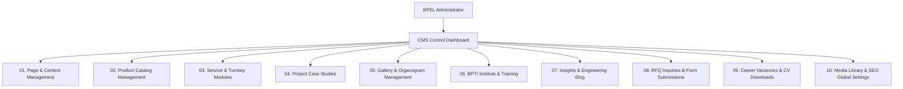
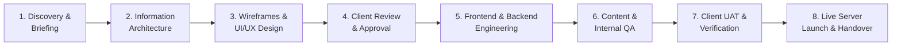

# Technical & Financial Proposal
## Website Design & Development for BPEL
**Version:** 2.0 (Comprehensive Project Document)  
**Date:** 24 September 2026 / Updated: 01 November 2026  
**Document Reference:** `Proposal_Website_Development_BPEL_V2.0`  

**Prepared for:**  
**Basic Power Engineering Ltd. (BPEL)**  
Spring Rahmat-E-Tuba Complex, House#132, Road# 02, Block# A, Section# 12, Mirpur, Dhaka-1216  
Corporate Office: Level 11, BPEL Tower, Plot 34, Gulshan South Avenue, Gulshan-1, Dhaka 1212  
Factory: BPEL Industrial Park, Tongi-Gazipur Highway, Gazipur, Bangladesh  

**Proposed by:**  
**Dcastalia Limited / Enterprise Digital Engineering Team**  
House 91, Road 04, Block B, Banani, Dhaka 1213  
Website: dcastalia.com • Email: info@dcastalia.com  

---

## Table of Contents

- [1. About the Development Agency (Dcastalia Limited)](#1-about-dcastalia-limited)
- [2. Executive Summary](#2-executive-summary)
- [3. Project Understanding](#3-project-understanding)
- [4. Scope of Work (SOW)](#4-scope-of-work-sow)
  - [4.1. Website Design & Development](#41-website-design--development)
    - [a. Discovery & Planning](#a-discovery--planning)
    - [b. Design & User Experience (UI/UX)](#b-design--user-experience-uiux)
    - [c. Front-End & Back-End Development](#c-front-end--back-end-development)
    - [d. SEO Optimization](#d-seo-optimization)
    - [e. Performance Optimization](#e-performance-optimization)
    - [f. Launch & Handover](#f-launch--handover)
  - [4.2. Website Structure & Core Modules Development](#42-website-structure--core-modules-development)
    - [01. Global Components (Header, Footer, Sticky CTA, Profile Access)](#01-global-components)
    - [02. Homepage (Hero, Overview, Products, Services, Projects, Why BPEL, Partners)](#02-homepage)
    - [03. About Us (Journey, Vision & Values, Leadership, Team, Facility, Quality)](#03-about-us)
    - [04. Our Organogram (Hierarchy, Viewer, Download/View)](#04-our-organogram)
    - [05. Our Gallery (Categories, Lightbox, Media Viewer)](#05-our-gallery)
    - [06. Our Projects (Listing with Filters, Details Case Studies)](#06-our-projects)
    - [07. Our Services (Substation, Transformer Rental, Panels, BBT, Automation)](#07-our-services)
    - [08. Our Products (Listing, Parameter Tables, Applications, Standards)](#08-our-products)
    - [09. Our Institute / BPTI (Technical Training, Programs, Facilities, Registration)](#09-our-institute--bpti)
    - [10. Insights / Blog (Articles, News, Events, Social Sharing)](#10-insights--blog)
    - [11. Career (Culture, Job Openings, Details, Application Form with CV Upload)](#11-career)
    - [12. Contact Us (Contact Info, Office Directory, Google Map, RFQ Form)](#12-contact-us)
    - [13. Privacy Policy](#13-privacy-policy)
    - [14. Terms & Conditions](#14-terms--conditions)
    - [15. Interactive Engineering Calculators (15 IEC/IEEE Dedicated Tools)](#15-interactive-engineering-calculators)
    - [16. Autonomous AI Sales & Quoting Agent (Engr. Tanvir Ahmed)](#16-autonomous-ai-sales--quoting-agent)
  - [4.3. Admin Panel (CMS)](#43-admin-panel-cms)
  - [4.4. Content Integration & Data Presentation](#44-content-integration--data-presentation)
- [5. Technical Specifications](#5-technical-specifications)
  - [01. Development Platform & Architecture](#01-development-platform--architecture)
  - [02. Server & Runtime Requirements](#02-server--runtime-requirements)
  - [03. Performance, Security & Code Quality](#03-performance-security--code-quality)
  - [04. Analytics & Reporting](#04-analytics--reporting)
  - [05. Quality Assurance & Testing Protocol](#05-quality-assurance--testing-protocol)
- [6. Project Timeline & Delivery Milestones](#6-project-timeline)
- [7. Work Process](#7-work-process)
- [8. Project Team Structure](#8-project-team)
- [9. Warranty & Deliverables](#9-warranty--deliverables)
  - [9.1. Post-Launch Warranty Support (1-Month Complimentary)](#91-post-launch-warranty-support-1-month)
  - [9.2. Final Deliverables](#92-final-deliverables)
- [10. Investment & Commercials](#10-investment--commercials)
- [11. Optional Services](#11-optional-services)
- [12. Terms of Service](#12-terms-of-service)
  - [12.1. Contents & Copyright](#121-contents--copyright)
  - [12.2. Payment Terms & Milestone Phases](#122-payment-terms--phases)
  - [12.3. Definition of New Requirements (Change Request / CR)](#123-definition-of-new-requirement-cr)
  - [12.4. Deadlines, Project Duration & Support Conditions](#124-deadline-milestones-project-duration--after-sales-service)
  - [12.5. Third-Party Services & Hosting Responsibilities](#125-third-party-services--hosting)
  - [12.6. General Legal Terms & Acceptance Sign-off](#126-other-terms-of-service)

---

## 1. About Dcastalia Limited
**Experience, delivery capability and client trust.**  
Since 2009, Dcastalia Limited has provided cutting-edge web engineering, software development, digital marketing, and technical infrastructure solutions, combining business strategy, human-centric design, and robust engineering to solve complex corporate requirements.

- **17+** Years of Industry Experience
- **1,650+** Clients Worldwide
- **2,000+** Completed Web & Enterprise Projects

### Industry & Global Reach
Dcastalia serves diverse corporate sectors including Power & Heavy Engineering, Real Estate, Telecommunications, Healthcare, Architecture, Government & NGOs, Garments, and Higher Education. Recognized and trusted globally for delivering high-performance, conversion-driven digital platforms.

---

## 2. Executive Summary
**A modern, scalable and conversion-focused digital platform for BPEL.**

Dcastalia Limited proposes to design and develop a modern, responsive, SEO-optimized digital platform for **Basic Power Engineering Ltd. (BPEL)**, focused on showcasing its power engineering products, electrical infrastructure solutions, turnkey EPC projects, services, and advanced technical capabilities. 

The new platform will enhance user experience, simplify product and service discovery, solidify corporate and industrial credibility among utilities (BPDB, DESCO, DPDC, BREB) and private sector conglomerates, accelerate qualified inquiry generation, and provide a scalable, easy-to-use CMS for ongoing content governance.

---

## 3. Project Understanding

Basic Power Engineering Ltd. (BPEL) is a premier power engineering and electrical solutions manufacturer in Bangladesh offering heavy products and services including:
- High-voltage & medium-voltage transformers (up to 16,000 kVA / 33 kV)
- Medium & low voltage switchgear panels (HT/LT panels, MDB, MCC, PFI)
- Busbar Trunking Systems (BBT)
- Substation automation & instrument calibration
- Turnkey complete substation solutions (11 kV & 33 kV)
- Servicing, testing, retrofitting, and system upgrading

The website serves as BPEL’s primary digital platform for presenting its equipment lines, manufacturing prowess, Gazipur factory testing facility, corporate leadership, and client-facing engineering resources.

### Primary Objectives of the Web Platform:
1. **Improve Overall User Experience:** Intuitive navigation, clear technical hierarchies, and rapid information access.
2. **Modernize the Website Design:** Contemporary, authoritative industrial aesthetics reflecting a world-class engineering conglomerate.
3. **Simplify Product & Service Exploration:** Instant specification lookup, parameters, standards, and high-definition photography.
4. **Increase Inquiry Conversion:** Strategic Request for Quotation (RFQ) CTAs, interactive calculators, and direct WhatsApp hotline access.
5. **Improve SEO Visibility:** Rank prominently for high-value power engineering search queries in Bangladesh and internationally.
6. **Enhance CMS Usability:** Enable BPEL technical and marketing staff to update products, projects, news, and vacancies without technical assistance.
7. **Build a Scalable Platform:** High-performance architecture ready for future product lines, e-tendering, and client portal integrations.

---

## 4. Scope of Work (SOW)

The scope of this project covers the end-to-end design, development, content presentation, testing, and deployment of the website, focusing on uncompromising functionality, aesthetics, and digital performance.

### 4.1. Website Design & Development

#### a. Discovery & Planning
- Conduct detailed project briefing and technical requirement analysis sessions with BPEL stakeholders.
- Research global and regional power engineering competitors (ABB, Siemens, Energypac, Adex).
- Define website conversion goals, target audience personas (consultants, contractors, procurement heads), and user journeys.
- Create site map, content hierarchy, and Information Architecture (IA).
- Finalize key architectural components, technical stack, and CMS administrative requirements.

#### b. Design & User Experience (UI/UX)
- Develop wireframes for all primary and inner page templates.
- Design high-fidelity visual mockups in Figma based on BPEL corporate brand guidelines (Royal Blue, Deep Navy, Accent Sky, Crisp White).
- Ensure mobile-first, responsive, and WCAG 2.1 AA accessible layouts.
- Include up to 2 rounds of client feedback, fine-tuning, and revisions before design sign-off.

#### c. Front-End & Back-End Development
- Transform approved UI/UX designs into a clean, modular, and responsive web application using modern frontend technologies.
- Implement dynamic interactive elements: hero sliders, animated KPI counters, video background players, and tabbed specification tables.
- Build and integrate the custom Admin Panel (CMS) for seamless non-technical content management.
- Ensure cross-browser and cross-device consistency.

#### d. SEO Optimization
- Implement on-page SEO best practices: semantic HTML5 tags, structured heading hierarchy (`H1`–`H4`), schema markup, and image ALT tags.
- Optimize site speed, asset minification, image compression (AVIF/WebP), and browser caching policies.
- Configure XML sitemaps, `robots.txt`, Google Search Console, and Google Analytics (GA4) integration.
- Ensure complete SSL/HTTPS encryption and mobile responsiveness compliance.

#### e. Performance Optimization
- Thoroughly test all templates across modern web browsers (Chrome, Firefox, Safari, Edge) and operating systems.
- Verify all interactive forms, calculations, validation rules, and navigation flows.
- Conduct UX and load testing to guarantee high Google PageSpeed / Lighthouse scores (Target: 90+).
- Systematically debug and resolve issues prior to release.

#### f. Launch & Handover
- Deploy the production web application to the client's designated server or cloud CDN.
- Configure DNS records, SSL certificates, automated backups, and server security directives.
- Provide comprehensive CMS user training for BPEL’s designated administrators.
- Deliver full project files, credentials, user guides, and technical handover documentation.

---

### 4.2. Website Structure & Core Modules Development

Below is the detailed specification of all pages, sections, modules, and user-facing features:

| # | Module / Page | Sections / Components | Key Features & Functional Details |
|---|---|---|---|
| **01** | **Global Components** | **Header & Navigation** | • Official BPEL vector logo<br>• Primary mega-menu navigation (Products, Services, Industries, About, Resources)<br>• Header "Request a Quote" / Inquiry CTA button<br>• Fully responsive mobile drawer menu with touch-friendly accordion |
| | | **Footer** | • Company intro, quick links, contact info, office address<br>• Social media links and copyright notice<br>• "View Company Profile" button<br>• "Download Company Profile PDF" direct action |
| | | **Sticky Floating Actions** | • Persistent quick-contact triggers (RFQ Form, Telephone Hotline, Instant WhatsApp direct link) |
| | | **Company Profile Access** | • Integrated PDF viewer modal opening directly from the footer without forcing page redirection |
| **02** | **Homepage** | **Hero Banner / Slider** | • High-impact image & 3D video looped backdrop (up to 20-second duration)<br>• Headline messaging, engineering badges, and primary action CTAs |
| | | **Company Overview** | • Conciseness on BPEL's 35+ years of engineering heritage and manufacturing capacity<br>• Link to full About page |
| | | **Key Stats Bar** | • Animated counters (35+ Years, 10,000+ Installations, 16,000 kVA Max Capacity, 12+ Licences) |
| | | **Featured Products** | • Grid showcasing flagship transformers, switchgear, and package substations with quick spec highlights |
| | | **Our Services** | • 6 Core Service Cards: Complete Substation, Distribution Panels, Transformer Supply/Rental, BBT, Servicing & Upgrading, Automation |
| | | **Featured Projects** | • Showcase of completed national grid and industrial turnkey installations with client name and location |
| | | **Why BPEL** | • Engineering capability, 120,000 sq.ft Gazipur manufacturing campus, accredited testing lab, and certified metallurgy |
| | | **Clients / Trusted By** | • Logo wall displaying utility approvals (BPDB, DESCO, DPDC, BREB) and industrial client groups |
| | | **Certifications & Partners**| • Display of ISO 9001:2015, BSTI, CNAS, IAF, ILAC MRA marks and technical partner logos |
| | | **Insights Preview** | • Latest 3 engineering whitepapers and industry news cards |
| | | **Final Contact CTA** | • Full-width conversion banner inviting technical tenders and RFQ submissions |
| **03** | **About Us** | **Company Overview** | • Detailed corporate narrative, engineering philosophy, and infrastructure scale |
| | | **Our Journey** | • Interactive historical timeline: 2008 establishment, workshop launch, factory expansion in Gazipur, national grid integration |
| | | **Vision, Mission & Values** | • Formal vision statement, mission statement, and core cultural values |
| | | **Leadership & Board** | • Messages and profiles for Chairman, Managing Director (Engr. Md. Ashraful Islam, FIEB), and Director of R&D (Dr. Rezaul Karim, Ph.D. Imperial College) |
| | | **Our Team / Engineers** | • Overview of technical workforce, design engineers, testing lab specialists, and plant staff |
| | | **Manufacturing Facility** | • Comprehensive overview of Gazipur plant: coil winding bays, CRGO core cutting slitting lines, vacuum drying autoclaves |
| | | **Testing & Quality Lab** | • Detailed capability overview: Routine FAT testing, Type testing (BIL Impulse, Heat Run), Special diagnostics (SFRA, DGA) |
| | | **Certifications & Accreditations** | • High-resolution display and details of ISO 9001, ISO 14001, CPRI/STL witness reports, and government licences |
| **04** | **Our Organogram** | **Organizational Structure** | • Visual organogram illustrating BPEL's corporate governance, department hierarchy, and management lines |
| | | **Organogram Viewer** | • Interactive full-screen viewer and zoomable graphic |
| | | **Download / View** | • Direct PDF download and QR access for mobile review |
| **05** | **Our Gallery** | **Gallery Listing** | • High-resolution multimedia media gallery categorized by department and activity |
| | | **Gallery Categories** | • 1. Factory & Manufacturing • 2. Products • 3. Projects • 4. Team & Corporate • 5. Events & Training |
| | | **Lightbox Viewer** | • Responsive full-screen lightbox with smooth next/prev navigation |
| **06** | **Our Projects** | **A. Project Listing** | • Grid layout of turnkey EPC deployments with category filters (Grid Substation, Heavy Industry, Commercial, Solar, Textile) |
| | | **B. Project Details** | • In-depth case study page: Project Overview, Client name, Location, Voltage ratio, Capacity (MVA), Scope of work, and Site photo gallery |
| **07** | **Our Services** | **Services Overview** | • Technical overview of BPEL’s turnkey electrical EPC and servicing capability |
| | | **Complete Substation** | • 11 kV & 33 kV turnkey substation engineering: Transformer + HT Switchgear + LT Panel + PFI + Protection |
| | | **Transformer Supply & Rental** | • Fast-track equipment supply and industrial rental transformer service for emergency plant outages |
| | | **Panel & Switchgear Services**| • Custom fabrication of MV distribution switchboards, MDB, SDB, MCC, and HT/LT panels |
| | | **Busbar Trunking (BBT)** | • Import, sizing, layout design, installation, testing, and periodic maintenance of BBT systems |
| | | **Servicing & System Upgrades**| • Preventive maintenance, tap changer servicing, bushing replacement, and substation capacity augmentation |
| | | **Automation & Calibration** | • Substation SCADA automation, protective relay calibration, secondary injection testing, and ELB clearance support |
| | | **Service Inquiry CTA** | • Dedicated service request form with direct technician dispatch options |
| **08** | **Our Products** | **A. Product Listing** | • Comprehensive categorized equipment catalog (Transformers, Medium/High Voltage, Switchgear Assemblies) |
| | | **B. Product Details Page**| • High-resolution equipment photography and 3D angle views<br>• Technical Parameters Table (kVA, Voltage, Cooling, %Z, BIL, Vector Group)<br>• Applications & Industry Fit<br>• Standard Compliance (IEC 60076, IEEE C57)<br>• Instant "Inquire for this Product" RFQ modal |
| **09** | **Our Institute / BPTI** | **Institute Overview** | • Introduction to Basic Power Technical Institute (BPTI) initiative for engineering skills development |
| | | **Training Programs** | • Switchgear Operation & Maintenance • Substation Automation • Mechanical Fabrication • Electrical Estimation & Substation Design |
| | | **Training Facilities** | • Practical high-voltage laboratory environment and equipment demonstration bays |
| | | **Upcoming Schedules** | • Program dates, duration, eligibility, and course outlines |
| | | **Registration / Inquiry** | • Online enrollment registration form and inquiry desk |
| **10** | **Insights / Blog** | **A. Blog Listing** | • Card grid displaying technical whitepapers, company updates, and grid engineering guides with category tabs |
| | | **B. Individual Article Page**| • Full-text technical article, featured photography, author bio, key takeaways box, and social sharing links |
| **11** | **Career** | **Culture & HR Philosophy** | • Working culture at BPEL, safety standards, and engineering career growth pathways |
| | | **Job Openings** | • Live vacancy directory with department filters (Design, QA/Testing, Plant Operations, Sales) |
| | | **Job Details** | • Responsibilities, educational requirements (BUET/KUET/CUET/RUET), experience criteria, and salary benefits |
| | | **Application Form** | • Interactive online job application with resume/CV file upload (.pdf, .docx) |
| **12** | **Contact Us** | **Contact Information** | • Corporate HQ address (Gulshan-1), factory address (Gazipur), official phone, hotline, and email addresses |
| | | **Location & Map** | • Embedded interactive Google Map with satellite plinth visualization |
| | | **Contact & RFQ Form** | • Multi-field inquiry form with pre-selected service/product routing and office selection |
| **13** | **Privacy Policy** | **Policy Sections** | • GDPR and national data protection compliant legal disclosure on data collection and inquiry retention |
| **14** | **Terms & Conditions** | **Terms Sections** | • Intellectual property rights, quotation validity periods, and web usage regulations |
| **15** | **15 Engineering Calculators** | **Interactive Engineering Suite** | • 15 Dedicated Tools (kVA Sizing, Cable Sizing, 30-Year TCO, Loss & Efficiency, Short Circuit, Tap Changer, Oil Volume, LME Commodity Tracker, CO₂ Abatement) adhering to IEC 60076 & IEEE standards |
| **16** | **Autonomous AI Sales Agent** | **Engr. Tanvir Ahmed (AI Specialist)** | • Natural language kVA parsing, instant budgetary quotations in BDT/USD with official quote IDs, automated work orders, and Google Gemini 1.5 Flash multimodal file analysis |

---

### 4.3. Admin Panel (CMS)

The web platform includes a secure, intuitive Content Management System (CMS) enabling authorized administrators to update all sections without direct code modifications:



| # | CMS Module | Key Management Features |
|---|---|---|
| **01** | **Dashboard** | System overview, recent RFQ count, application counters, quick-access action shortcuts. |
| **02** | **User & Role Management** | Admin user creation, permission tiers (Super Admin, Editor, HR Manager, Sales Viewer). |
| **03** | **Page & Content Management** | Manage static copy, homepage hero banners, company overview text, and footer details. |
| **04** | **Product Management** | Add/edit/delete products, manage categories, upload spec tables, parameters, and photos. |
| **05** | **Service Management** | Manage service categories, detailed scopes of work, and engineering inclusions. |
| **06** | **Project Management** | Publish completed project case studies, client names, MVA capacities, locations, and photo sets. |
| **07** | **Gallery Management** | Organize media into Factory, Product, Project, Corporate, and Event categories. |
| **08** | **Organogram Management** | Update corporate organizational chart graphics, PDFs, and QR download links. |
| **09** | **Concern & Institute Management** | Manage sister concerns, BPTI technical courses, schedules, and trainee registrations. |
| **10** | **Insights / Blog Management** | Draft, edit, and publish engineering whitepapers and articles with tag management. |
| **11** | **Form & Inquiry Management** | Centralized database of all RFQs, service inquiries, and quotation requests with CSV/Excel export. |
| **12** | **Career Management** | Post job vacancies, set deadlines, review candidate applications, and download submitted CVs. |
| **13** | **Media & Document Library** | Central repository for product images, videos, brochures, and PDF company profile downloads. |
| **14** | **Website & SEO Settings** | Configure global meta titles, descriptions, OpenGraph tags, Google Analytics ID, and social links. |

---

### 4.4. Content Integration & Data Presentation

| Item | Scope Description |
|---|---|
| **Initial Content Integration** | • Up to **5 standard static pages** populated with client-provided text and assets.<br>• Up to **10 detailed project / product / news entries** formatted and published.<br>• Up to **20 resized, compressed, and web-optimized images** placed in the gallery and showcase sections. |
| **Additional Content Entry** | For content entry beyond the initial baseline, an additional fee of **BDT 3,000 per page** (up to 1,500 words per page) will apply. |

---

## 5. Technical Specifications

### 01. Development Platform & Architecture
- **UI/UX Design & Interactive Prototyping:** Executed in **Figma** with fully linked user journeys and component states.
- **Frontend Framework:** **Next.js 16 (App Router)** & **React 19**, written in clean, modern JavaScript/TypeScript.
- **Styling Architecture:** Pure CSS Custom Properties (`app/common.css`) with zero-runtime CSS overhead for instant load performance.
- **Micro-Interactions & Animation:** **Anime.js** and **Animate.css** for hardware-accelerated viewport motion.
- **Backend / CMS & Data Layer:** Modern Node.js runtime with decoupled ES Module and JSON storage architecture, supported by secure serverless API handlers (`app/api/chat/route.js`).
- **AI Intelligence:** Integrated **Google Gemini 1.5 Flash API** for multimodal technical inquiries and conversational engineering support.

### 02. Server & Runtime Requirements
- **Runtime Environment:** Node.js version `20.9.0` or higher.
- **Server Specifications:** Minimum 4 GB RAM, 2 Core vCPU, SSD storage.
- **Static Export Deployment:** Built-in capability to generate 100% static HTML/CSS/JS export (`out/` directory), deployable on any high-availability Edge CDN (Cloudflare Pages, AWS S3/CloudFront, Netlify, Nginx).
- **HTTPS & SSL:** Mandatory TLS 1.3 / SSL encryption certificate enabled on all endpoints.

### 03. Performance, Security & Code Quality
- **Cross-Browser Compatibility:** Full visual and functional consistency across Chrome, Firefox, Safari, Edge, and Opera across Desktop, Tablet, and Mobile devices.
- **Web Security (OWASP Aligned):** Input sanitization (`escapeHtml`), strict XSS protection, zero SQL injection attack surface, and security headers (`X-Content-Type-Options: nosniff`, `X-Frame-Options: SAMEORIGIN`).
- **Performance Budget:** Google PageSpeed / Lighthouse target score of **90+** with First Contentful Paint (FCP) under 1 second.
- **Asset Optimization:** Automated Next.js AVIF/WebP image compression, script tree-shaking, and 1-year immutable caching headers.

### 04. Analytics & Reporting
- Full integration with **Google Analytics 4 (GA4)** and **Google Search Console**.
- Basic performance and error monitoring tracking broken links, form completions, and RFQ conversions.

### 05. Quality Assurance & Testing Protocol
- Comprehensive UI/Visual regression testing.
- Cross-browser and device responsiveness testing.
- Mathematical validation of all 15 calculators against standard IEC 60076 equations.
- Formal User Acceptance Testing (UAT) sign-off prior to production launch.

---

## 6. Project Timeline

The total estimated development timeline is **30 Working Days** from the date of formal Work Order signing and advance payment clearance:

| # | Milestone Phase | Key Outputs & Activities | Duration |
|---|---|---|---|
| **01** | **Discovery & Planning** | Requirement analysis, sitemap, information architecture, and technical roadmap finalization. | **2 Working Days** |
| **02** | **UX/UI Design & Prototyping** | Wireframes, high-fidelity Figma UI designs, component library, and interactive client prototype. | **7 Working Days** |
| **03** | **Development & CMS Integration** | Frontend coding, core modules, 15 calculators, AI agent, CMS backend, and dynamic forms. | **15 Working Days** |
| **04** | **Content Integration & QA** | Initial content population, multi-device responsive testing, functional QA, and performance optimization. | **4 Working Days** |
| **05** | **UAT, Deployment & Handover** | Client User Acceptance Testing (UAT), production server launch, CMS training, and final documentation. | **2 Working Days** |
| **—** | **Total Estimated Duration** | **Full Turnkey Delivery** | **30 Working Days** |

---

## 7. Work Process

The project follows a disciplined, transparent, and accountable delivery pipeline:



Each stage is formally reviewed and signed off before advancing to the subsequent phase, ensuring total scope alignment, quality assurance, and zero timeline slippage.

---

## 8. Project Team

The project will be managed and executed by an experienced cross-functional digital engineering team:

| Role | Primary Responsibilities | Industry Experience |
|---|---|---|
| **Project Manager** | Project coordination, stakeholder communication, sprint scheduling, and risk mitigation. | **5+ Years** |
| **Creative Director** | UI/UX aesthetic direction, information architecture, visual branding, and design quality. | **7+ Years** |
| **Senior Frontend Developer** | Next.js 16/React 19 implementation, responsive layouts, micro-interactions, and web performance. | **5+ Years** |
| **Full-Stack Developer** | CMS architecture, API integrations, data modeling, calculator engines, and AI agent logic. | **7+ Years** |
| **DevOps / QA Lead** | Server configuration, security hardening, automated build testing, and quality assurance. | **9+ Years** |
| **Support & Analytics Engineer** | Google Analytics setup, uptime monitoring, bug tracking, and post-launch technical assistance. | **5+ Years** |
| **Content & Data Specialist** | Product catalog structuring, spec table formatting, image web optimization, and data entry. | **2+ Years** |
| **Account Manager** | Commercial coordination, milestone billing, and ongoing client partnership support. | **3+ Years** |

---

## 9. Warranty & Deliverables

### 9.1. Post-Launch Warranty Support (1-Month Complimentary)
- Full remediation of any bugs or defects related to the agreed scope of work.
- Resolution of any layout anomalies identified across supported browsers.
- Basic server uptime and error monitoring.
- Post-launch technical guidance and troubleshooting.
*(Ongoing monthly support and maintenance are available under our optional Maintenance Contract).*

### 9.2. Final Deliverables
1. Fully functional, mobile-responsive corporate web platform.
2. Custom CMS with all approved management modules.
3. Complete source code repository with technical documentation.
4. Approved Figma UI/UX design assets and component system.
5. Production deployment and server configuration on the client's infrastructure.
6. Google Analytics 4, Search Console, and basic on-page SEO integration.
7. CMS user manual and dedicated staff training session.
8. 1-Month complimentary post-launch warranty support.

---

## 10. Investment & Commercials

Transparent milestone-based commercial structure aligned with the approved scope:

| # | Scope / Deliverable | Investment (BDT) |
|---|---|---|
| **1** | **UX/UI Design, Wireframing & Interactive Prototyping** | 90,000 |
| **2** | **Website Development, Core Modules, Calculators & AI Agent** | 150,000 |
| **3** | **Custom CMS Development & Administrative Integration** | 55,000 |
| **4** | **Content Integration, Formatting & Functional QA** | 30,000 |
| **5** | **Production Server Setup, SSL, Caching & Deployment** | 15,000 |
| **6** | **Post-Deployment Warranty Support (1 Month Free)** | **Included (0)** |
| **—** | **Total Project Investment** | **BDT 340,000** |

*Note: All prices are exclusive of VAT. A 5% VAT will be added to the total amount at invoicing as per Government of Bangladesh regulations.*

---

## 11. Optional Services

Available separately upon request to support long-term operations:

| Service | Detailed Scope Description | Cost |
|---|---|---|
| **Maintenance Service (Standard)** | **Security & Monitoring:** Monthly vulnerability scans, codebase & database backups, link and form health checks.<br>**Optimization:** Monthly PageSpeed audit, GA4 monthly traffic reporting.<br>**Technical Support:** Bug fixes & technical consultation up to 8 hours/month, issue resolution within 72 hours. | **BDT 8,000 / Month** |
| **Managed Cloud Hosting** | 5 GB SSD storage, 16 GB shared RAM, 8-core vCPU, 100 GB monthly bandwidth, automated daily backups, managed Plesk/cPanel, 99.99% uptime guarantee. | **BDT 35,000 / Year** |
| **Professional Technical Copywriting** | Up to 5,000 words of technical corporate copy aligned with BPEL’s brand voice, product specs, and target industrial audience. Includes 3-day discovery and 2 rounds of revisions. | **BDT 65,000** *(One-time)* |
| **Graphic & Asset Support** | Up to 20 premium licensed stock images, custom image retouching, color grading, and up to 10 bespoke vector icons tailored to power engineering. | **BDT 40,000** *(One-time)* |

---

## 12. Terms of Service

### 12.1. Contents & Copyright
- The client (BPEL) is responsible for supplying all official company text, logo files, certifications, product datasheets, and high-resolution photography.
- Content writing and on-site factory photography are excluded unless separately engaged under Section 11.
- BPEL retains 100% intellectual property rights and copyright of all client-supplied materials and holds sole responsibility for copyright clearance.

### 12.2. Payment Terms & Milestone Phases
Payments shall be disbursed in accordance with four clear project milestones:

| Milestone Phase | Percentage | Amount (BDT) | Trigger Milestone Event |
|---|---|---|---|
| **1. Project Initiation** | **30%** | 102,000 | Formal Work Order signing & contract execution. |
| **2. UI/UX Approval** | **30%** | 102,000 | Final sign-off on Figma UI/UX designs and prototype. |
| **3. Development Completion** | **30%** | 102,000 | Completion of frontend, core modules, CMS, and calculators. |
| **4. UAT & Final Launch** | **10%** | 34,000 | Client UAT sign-off, live deployment, and training handover. |
| **Total** | **100%** | **BDT 340,000** | *(Exclusive of 5% VAT)* |

- **VAT:** 5% VAT applies as per current National Board of Revenue (NBR) regulations.
- **TAX:** Income TAX is exempted for IT/ITES services under prevailing Government of Bangladesh Finance Acts.
- Full handover of final source code, credentials, and documentation will occur upon receipt of final milestone payment.

### 12.3. Definition of New Requirements (Change Request / CR)
- Any structural or functional modifications requested after the approval of UI/UX designs will be classified as a **New Requirement (Change Request)**.
- Feedback exceeding the agreed scope of work in Section 4 will be scoped and costed separately.
- Standard Change Request engineering rate: **BDT 10,000 per man-day**.

### 12.4. Deadlines, Project Duration & Support Conditions
- Timelines rely on prompt feedback; client review delays exceeding 10 consecutive working days may lead to project schedule pausing.
- The maximum permissible project completion window is 6 months from agreement signing.
- Includes 1 month of complimentary warranty support post-launch for scope-related bug fixing.

### 12.5. Third-Party Services & Hosting
- Costs exclude recurring fees for any third-party paid APIs, premium email services, or dedicated SMS gateways.
- BPEL shall provide access to the production server/hosting environment unless Dcastalia’s managed hosting is selected.

### 12.6. Other Terms of Service
- This proposal remains valid for **60 days** from the date of issuance.
- A discreet credit line acknowledging the development partnership may be placed in the footer unless agreed otherwise in writing.
- Deployment to the live production server will occur upon final UAT approval.

---

### Formal Acceptance & Authorization

**Accepted and Agreed on behalf of Basic Power Engineering Ltd. (BPEL):**

```
Signature: _________________________________________
Name:      _________________________________________
Title:     Managing Director / Director, BPEL
Date:      _________________________________________
Company Seal:
```

**Submitted on behalf of Dcastalia Limited:**

```
Signature: _________________________________________
Name:      Md. Shahariar Rahman
Title:     Director of Projects & Solutions Architecture
Date:      24 September 2026 / 01 November 2026
```

---
*Document Authenticated & Maintained under the BPEL Digital Engineering Initiative.*  
Gulshan Tower, Dhaka 1212 • `info@bpel-power.com` • `dcastalia.com`
